

  

  
  
  
  
  

<b>A <a href="https://github.com/radhepa/Village-Friends-Minecraft-Mod">Village Friends</a> add-on that gives the sea two peoples to befriend.</b> 
Merfolk in Reef Towns on the warm sea floor, and the one-eyed Prismari in the Prism Courts of the deep.

<table>
  <tr>
    <td width="50%">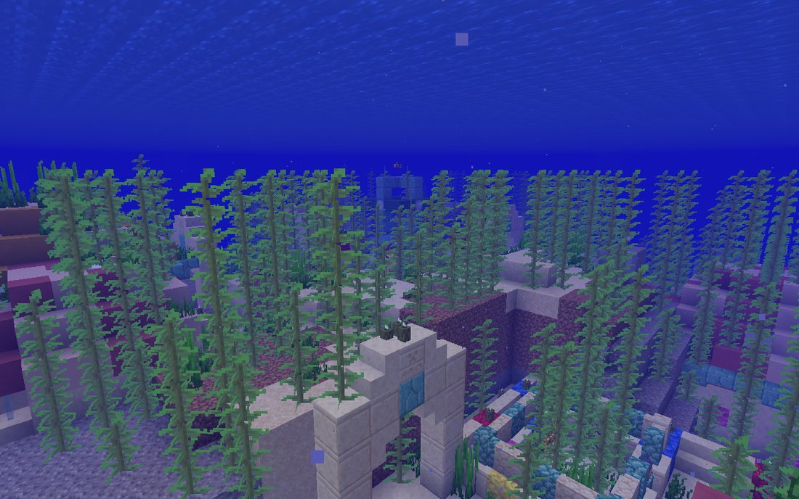 A merfolk <b>Reef Town</b> of coral, sandstone and shell.</td>
    <td width="50%">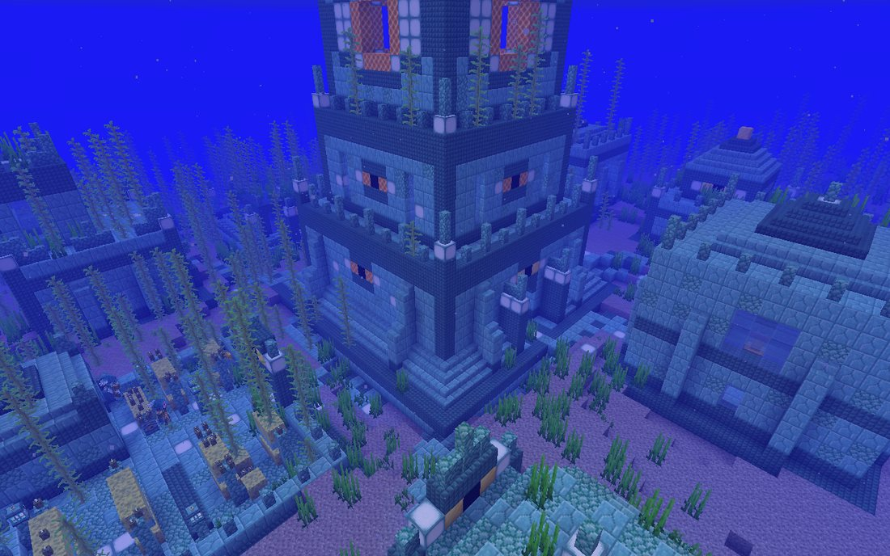 A Prismari <b>Prism Court</b> round its Eye Spire.</td>
  </tr>
</table>

---

## The peoples


Village Friends villagers from the waist up (the same faces, hair, names, personalities, friendship and conversation
window) with a fish tail below, its colour running in families. They dress in their own wardrobe instead of land
clothes: twenty men's tops, from bare chests with shell cords, kelp sashes and pearls to scale vests and nautilus
armour, and twenty women's tops, from scallop tops and scale bandeaus to sea-silk blouses and elder robes, all in ten
sea palettes. Jobs have their own looks: wardens wear armour, elders wear robes.

They live in **Reef Towns** of coral, sandstone and shell on the floor of warm and temperate seas, around a Tide Shrine
whose **conduit** lets you breathe while you visit. They swim upright when they idle and lean into a stroke when they
travel; on land they flop back toward the water.

**Jobs:** Pearl Divers (Tidepearls, prismarine, nautilus shells), Kelp Farmers (kelp, kelp wraps, fish), Shellwrights
(coral, nautilus saddles and armor, spears), Tide Singers (water breathing and night vision, the Conch, a conduit),
Reef Wardens (Village Friends knights with tridents) and the Elder. Their children grow up. They keep the vanilla
nautili in their stables and leafy seadragons in their gardens.

<table>
  <tr>
    <td width="50%">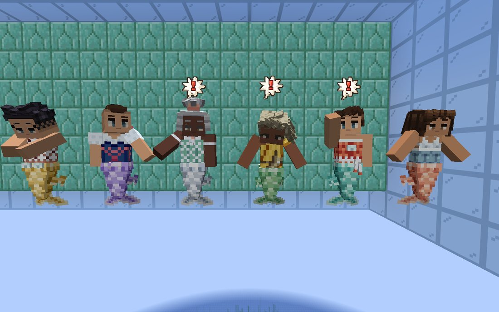 A few of the forty sea tops.</td>
    <td width="50%">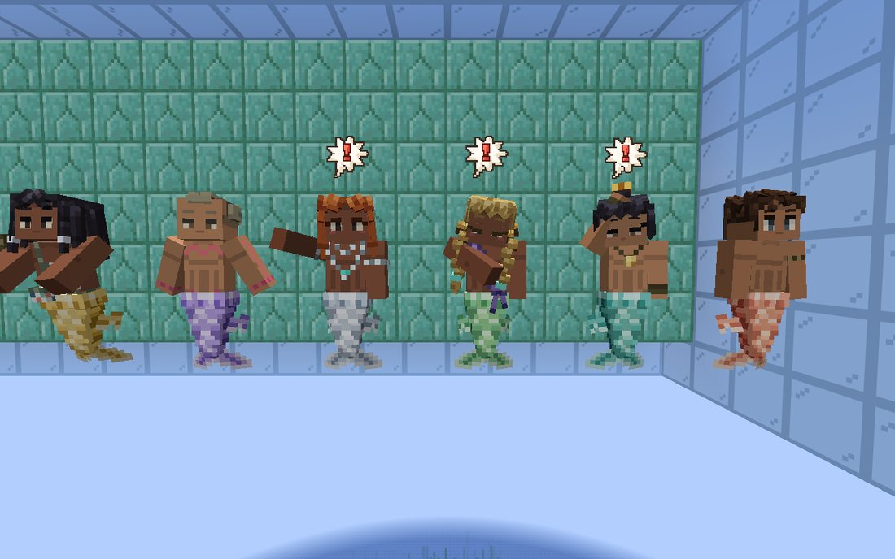 Tails run in families.</td>
  </tr>
</table>

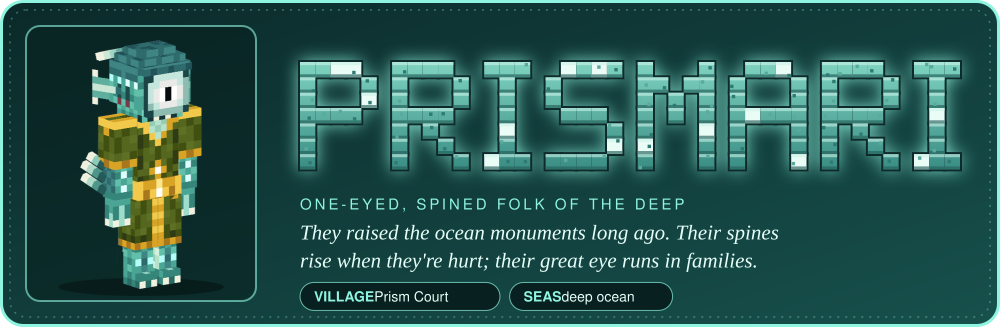

The one-eyed, spined folk of the deep who raised the ocean monuments long ago. Their spines rise when they're hurt or
angry; their great eye's colour runs in families. They live in **Prism Courts** in the deep ocean, around the Eye
Spire.

**Jobs:** Lightwrights (prismarine, sea lanterns, Tide Lamps), Spongekeepers (sponges, glowjellies), Archivists
(enchanted books), Eyeguards, and the Oldest Eye, who gives a trusted friend the **Monument Seal**: carry it, and
guardians and elder guardians leave you be.

<table>
  <tr>
    <td width="50%">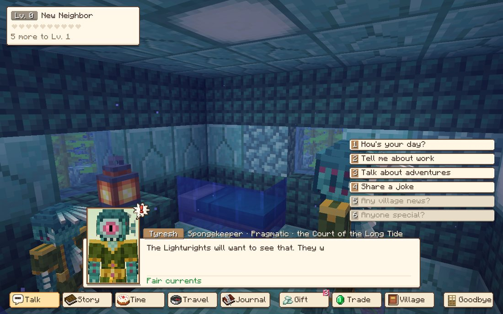 A Lightwright of the Court of the Long Tide.</td>
    <td width="50%">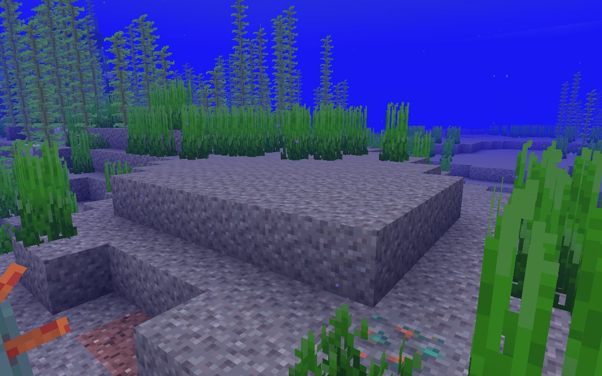 With the Monument Seal, guardians leave you be.</td>
  </tr>
</table>

## Friendship

Both peoples use Village Friends' conversation window, and every tab speaks for the sea:

<table>
  <tr>
    <td width="50%">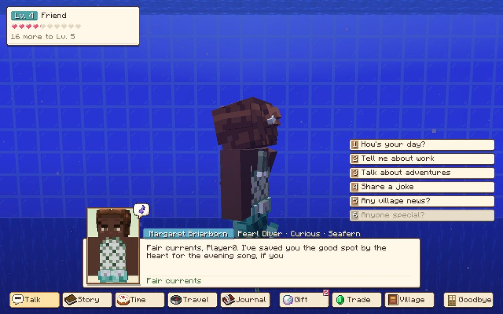 <b>Talk</b> with a Pearl Diver.</td>
    <td width="50%">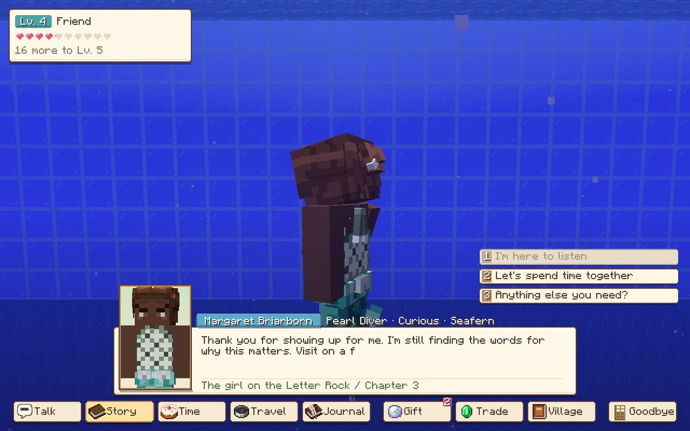 Her <b>Story</b>, in four chapters.</td>
  </tr>
  <tr>
    <td width="50%">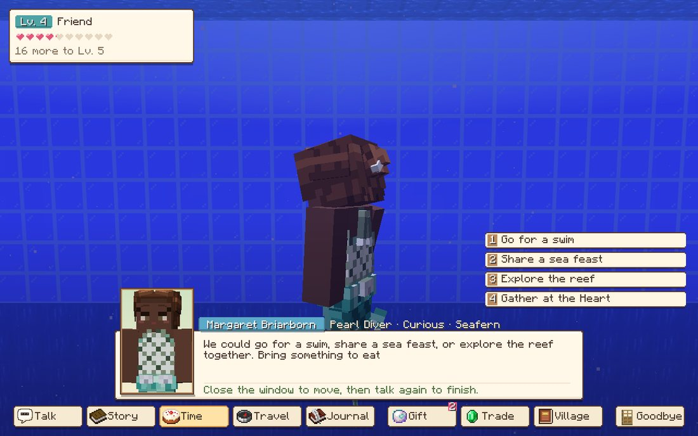 <b>Time</b> together: a swim, a sea feast, the reef.</td>
    <td width="50%">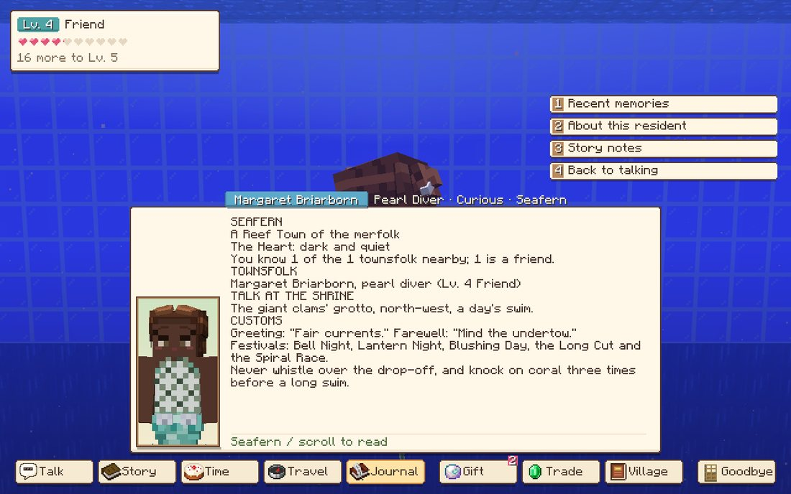 The <b>Journal</b>: memories and what you know of her.</td>
  </tr>
</table>

- **Talk**: their own lines on every topic (news and "anyone special" unlock with friendship as usual); once you're
  friendly they tell you about themselves; now and then they greet you remembering something you did together.
- **Story**: 24 personal stories of their own (12 merfolk, 12 Prismari, some written for a job), each in four
  chapters with three favours to fetch and a gift at the end.
- **Journal**: shared memories, about them (their sea hobby, loves and dislikes, their town) and story notes.
- **Time**: go for a swim, share a sea feast (fish, dried kelp, kelp wraps or a treat from the dry), explore the reef
  or the deep, or gather at the Heart.
- **Travel**: they swim with you through the sea (not onto the dry), and go home into the water afterwards.
- **Gift**: merfolk treasure pearls, shells, sea food and curiosities from the dry; the Prismari, things that shine
  or see. Each job has its favourites; a best friend slips you a sea present each day.
- **Village**: the town book of their Reef Town or Prism Court: who lives there and how well you know them, whether
  the Heart is humming, the talk of the town and its customs.

## Creatures and things


Tidepearl, kelp wrap, the Conch (half a minute of Conduit Power), the Monument Seal, the Tide Lamp, and the six
job-site blocks.

---

## Requirements

- Minecraft 26.3, Fabric Loader 0.19.5+, Fabric API
- [Village Friends](https://github.com/radhepa/Village-Friends-Minecraft-Mod) 2.29.0 or newer (both peoples are its
  residents underneath)
- Plays well with [Ocean Expansion](https://github.com/radhepa/OceanExpansion) (its sites and our villages keep
  apart; the sea folk tell you of its sites) and the rest of the Village Friends modpack.

## Settings

`config/seafriends.json`: `rarity`, `rumors`, `seal_friendship` (the friendship level with an Oldest Eye that earns
the Monument Seal, default 3).

## Building

`build.ps1` (or `gradlew build`).

| What | How |
|---|---|
| Villages | `python tools/villages/build.py` |
| Dialogue | `python tools/talk/talk.py` |
| Models | `python tools/models/build_all.py` |
| Block and item art | `python tools/art/blocks.py` |
| Merfolk clothes | `python tools/wardrobe/merwear.py` (previews: `tools/wardrobe/merpreview.py`) |
| Stories and tastes | `python tools/friendship/friendship.py` |

See [DESIGN.md](DESIGN.md).

## License

[MIT](LICENSE). The README art in `docs/readme/` is drawn from the mod's own models and in-game screenshots.
